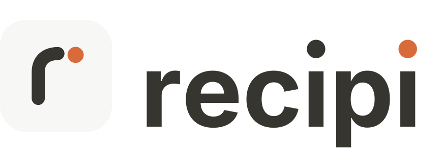

<h1 align="center">
  <picture>
    <source media="(prefers-color-scheme: dark)" srcset="design/icon/recipi-wordmark-dark.png">
    
  </picture>
</h1>

A free, open-source recipe manager for iPhone and iPad. Save recipes from any
website, keep them in one searchable library, and cook from them with a
distraction-free cooking mode. Your recipes sync through your own iCloud
account; there is no server, no account to create, and no subscription.

recipi is built as an open alternative to paid recipe apps like Mela.

## Features

### v1 (in progress)

- **Import from the web.** Paste a link, or share a page from Safari with the
  share sheet extension. recipi reads the schema.org `Recipe` data most recipe
  sites publish, and falls back to page heuristics (microdata and common
  WordPress recipe plugins) for sites that don't.
- **Add and edit by hand.** Title, photo, servings, ingredients, method, tags
  and notes.
- **Library.** Search by title or ingredient, filter by tag, with photos.
- **Cooking mode.** One step at a time, screen kept awake, and an ingredient
  checklist to tick off as you go.
- **Scaling and groceries.** Change the servings and every amount scales.
  Add a recipe's ingredients to the grocery list, or send the list to
  Reminders.
- **iCloud sync.** SwiftData with CloudKit, using your private database.

### v2 (planned)

- Import a Mela export
- Import from a photo or scan (OCR)
- Meal planning
- A Mac app

## Getting started

Requirements: Xcode 16 or later, iOS 18 or later, and
[XcodeGen](https://github.com/yonaskolb/XcodeGen).

```sh
brew install xcodegen
cp Config/Local.xcconfig.example Config/Local.xcconfig   # add your team ID
xcodegen
open Recipi.xcodeproj
```

The Xcode project is generated from `project.yml` and isn't checked in, so
run `xcodegen` again whenever you add files or change targets.

If you're building your own copy, set `RECIPI_BUNDLE_ID_PREFIX` in
`Config/Local.xcconfig` to something of your own. The bundle ID, App Group
and iCloud container are all derived from it.

## Project layout

```
project.yml              XcodeGen spec for the app and extension targets
Config/                  Shared build settings; signing goes in Local.xcconfig
Recipi/                  The iOS app (SwiftUI)
  App/                   Entry point and root tabs
  Features/              One folder per screen: Library, RecipeDetail,
                         Cooking, Editor, Import, Grocery
  Shared/                Small views used across features
RecipiShare/             Safari share sheet extension
Packages/RecipiKit/      Shared code: RecipiKit (SwiftData models, the
                         importer and parsers, ingredient scaling) and
                         RecipiDesign (colors, type, motion, components),
                         with tests
```

Anything both the app and the share extension need lives in RecipiKit. The
parsers and scaling logic are plain Swift, so they're covered by fast unit
tests:

```sh
swift test --package-path Packages/RecipiKit
```

## Contributing

Issues and pull requests are welcome. See [CONTRIBUTING.md](CONTRIBUTING.md)
for setup, conventions and the privacy rules every change keeps. If a recipe
site doesn't import correctly, please open an issue with the link. Fixes to
the fallback parser should come with a test that uses a trimmed copy of that
page's markup.

## License

[MIT](LICENSE)
