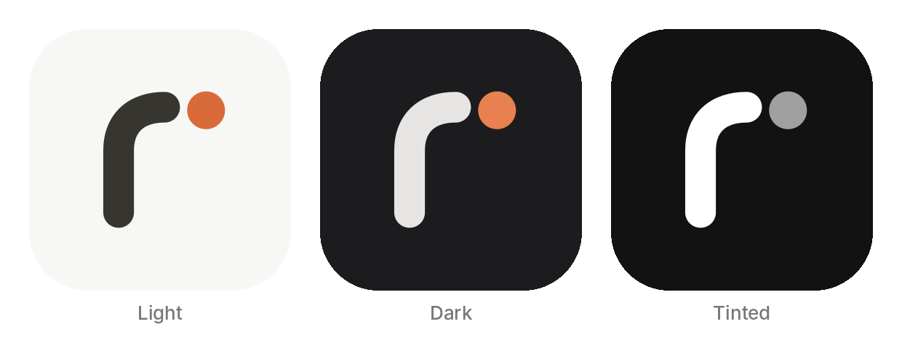
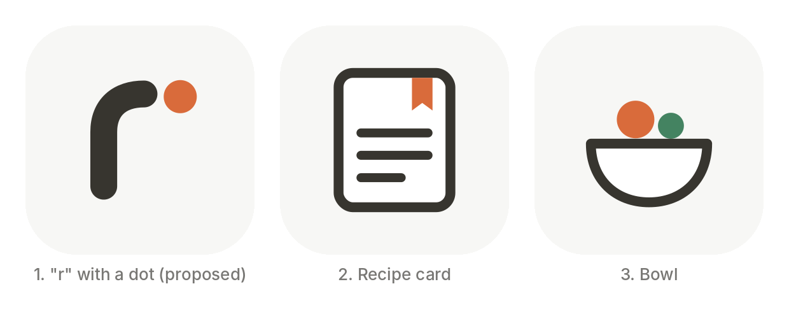

# Design

## App icon

The icon is a lowercase "r" drawn as one rounded stroke in recipi's ink
color, with a paprika dot after it: the same warm neutrals and accent as the
app's `Theme`.

- `icon/recipi-icon.svg`, `-dark.svg`, `-tinted.svg`: sources for the iOS 18
  light, dark and tinted icons. The light icon is opaque; the dark and tinted
  ones are transparent so iOS draws its own background behind them.
- `icon/make_icons.py`: builds all three SVGs and 1024 px PNGs from one set
  of numbers. After changing it, copy the PNGs into
  `Recipi/Resources/Assets.xcassets/AppIcon.appiconset/` as `AppIcon.png`
  (light, saved without alpha), `AppIcon-Dark.png` and `AppIcon-Tinted.png`.
- `icon/recipi-wordmark.svg` and `-dark.svg`: the icon plus "recipi" set in
  Inter Bold (outlined, so it doesn't depend on installed fonts), with the
  last i's dot in paprika. Used at the top of the README.

### Other directions explored

1. "r" with a dot (in use)
2. Recipe card with a bookmark
3. Bowl with two ingredients

Sources are in `icon/directions/`.
